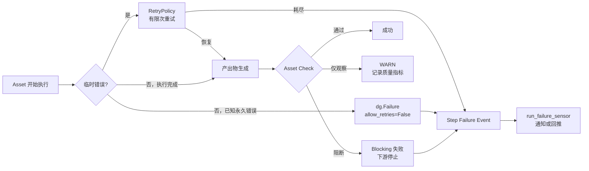

# 23 · Dagster 错误处理机制速览

> 配套 PPT：[Dagster 错误处理机制（7 页精简版）](../output/asset-check-error-handling/Dagster错误处理机制_精简版.pptx)  
> 用途：用最少的机制说明 Dagster 如何处理失败，不作为完整生产方案  
> 核心原则：先讲原生机制，再讲平台扩展

## 23.0 只需要记住四件事

| Dagster 机制 | 解决的问题 | 一句话说明 |
| --- | --- | --- |
| `RetryPolicy` / `RetryRequested` | 临时错误是否自动重试 | 只重试可能自行恢复的错误 |
| `dg.Failure(...allow_retries=False)` | 已知错误如何快速停止 | 不该重试的错误立即失败 |
| Asset Check | 数据质量是否可信 | 关键规则失败时阻止下游 |
| `run_failure_sensor` / `run_status_sensor` | 失败后如何感知 | 读取最终状态并触发通知或回推 |

一句话总结：

> 临时的自动重试，已知的立即止损，质量问题的用 Check 阻断，最终失败再由 Sensor 对外通知。

## 23.1 四类结果

| 结果 | 典型场景 | 使用的机制 | 下游 |
| --- | --- | --- | --- |
| 自动重试 | 网络抖动、429、对象存储超时 | `RetryPolicy` | 等待重试 |
| 快速失败 | schema 错误、权限错误、配置错误 | `dg.Failure(allow_retries=False)` | 停止，不继续 |
| 质量阻断 | JSON 不合法、关系端点不存在、格式缺字段 | blocking Asset Check | 阻断下游 |
| 仅观察 | 空抽取率升高、成本波动、置信度漂移 | non-blocking Check / WARN | 继续执行 |

判断方法：

- 等一会儿可能恢复：重试。
- 重试也不会恢复：立即失败。
- 计算完成但结果不可信：Asset Check。
- 可能有问题但暂时不能停线：WARN。

## 23.2 Dagster 内部发生什么



需要说明的两个边界：

1. **RetryPolicy 重试的是当前 step。** 跨小时等待上游、人工修复和跨 run 业务重试不属于 `RetryPolicy`。
2. **Sensor 不是消息队列。** Dagster 负责触发和回推，去重、工单、Outbox 和补偿对账属于平台层扩展。

## 23.3 最小代码形态

### 23.3.1 临时错误自动重试

```python
@dg.asset(
    retry_policy=dg.RetryPolicy(
        max_retries=2,
        delay=2,
        backoff=dg.Backoff.EXPONENTIAL,
    )
)
def diagram_page_json(context: dg.AssetExecutionContext) -> None:
    ...
```

适用：

- VLM 429
- 网络超时
- 对象存储短暂不可用
- 数据库短暂锁冲突

### 23.3.2 已知错误快速失败

```python
if not pdf_path.exists():
    raise dg.Failure(
        description="PDF 文件不存在",
        metadata={"error_code": "E_DATA_MISSING"},
        allow_retries=False,
    )
```

适用：

- 文件永久缺失
- schema 不符合契约
- 权限或凭证错误
- 配置错误

`allow_retries=False` 的作用是绕过该资产已经配置的 `RetryPolicy`，避免重复执行和浪费模型调用成本。

### 23.3.3 质量门禁

```python
@dg.asset_check(
    asset=kg_extraction,
    name="relation_endpoints_exist",
    blocking=True,
)
def relation_endpoints_exist(kg_extraction) -> dg.AssetCheckResult:
    bad = find_missing_relation_endpoints(kg_extraction)
    return dg.AssetCheckResult(
        passed=not bad,
        metadata={
            "rule_id": dg.MetadataValue.text("KE-KG-003"),
            "bad_count": dg.MetadataValue.int(len(bad)),
        },
    )
```

使用原则：

- 关键结构问题使用 `ERROR + blocking=True`。
- 模型质量和趋势指标先使用 `WARN`。
- check 没有产出结果时，blocking 不会自动生效，因此每个分支都必须返回结果。

### 23.3.4 最终失败通知

```python
@dg.run_failure_sensor
def notify_failure(context: dg.RunFailureSensorContext) -> None:
    ...
```

Sensor 适合做：

- 读取失败的 run 和分区
- 提取 `dg.Failure` metadata
- 回推业务状态
- 通知平台或团队

## 23.4 哪些是 Dagster，哪些是平台扩展

| 能力 | 归属 | 说明 |
| --- | --- | --- |
| Step 重试 | Dagster | `RetryPolicy` |
| 不可重试错误 | Dagster | `dg.Failure(allow_retries=False)` |
| 数据质量断言 | Dagster | Asset Check |
| 阻断下游 | Dagster | `ERROR + blocking=True` |
| 失败事件 | Dagster | Step failure event |
| 失败触发回调 | Dagster | `run_failure_sensor` |
| Incident 去重 | 平台扩展 | 业务库中的 incident 表 |
| 可靠通知 | 平台扩展 | notification outbox |
| 跨 run 业务重试 | 平台扩展 | task 表 + backfill |
| 漏告警补偿 | 平台扩展 | 对账 job |

汇报时建议把前六项称为“Dagster 机制”，后四项称为“运营增强”。这样不会把平台自研能力误解为 Dagster 原生能力。

## 23.5 一页汇报口径

如果只保留一页，建议按以下顺序讲：

1. **运行时失败**：临时错误按策略重试，已知永久错误立即失败。
2. **数据质量失败**：关键 Check 阻断下游，非关键 Check 进入 WARN。
3. **最终失败事件**：所有最终失败进入 Dagster 事件流。
4. **失败后动作**：Sensor 感知终态，回推业务状态或通知 owner。
5. **恢复**：修复后按分区补跑，不默认全量重跑。

这张表可以作为 PPT 的核心底稿：

| 问题 | Dagster 的回答 |
| --- | --- |
| 要不要重试 | `RetryPolicy` |
| 什么时候不该重试 | `dg.Failure(allow_retries=False)` |
| 数据能不能用 | Asset Check |
| 是否阻断下游 | `blocking=True` |
| 失败后怎么知道 | `run_failure_sensor` |
| 恢复多大范围 | Asset Partition |

## 23.6 不建议在这次说明中展开的内容

- 完整错误码分类体系
- Incident 表结构
- Notification Outbox 表结构
- 对账 job 的完整实现
- 多级告警冷却策略
- 跨 run 业务重试状态机
- 故障注入测试矩阵

这些属于生产化方案，可在确认 Dagster 机制后再单独展开。

