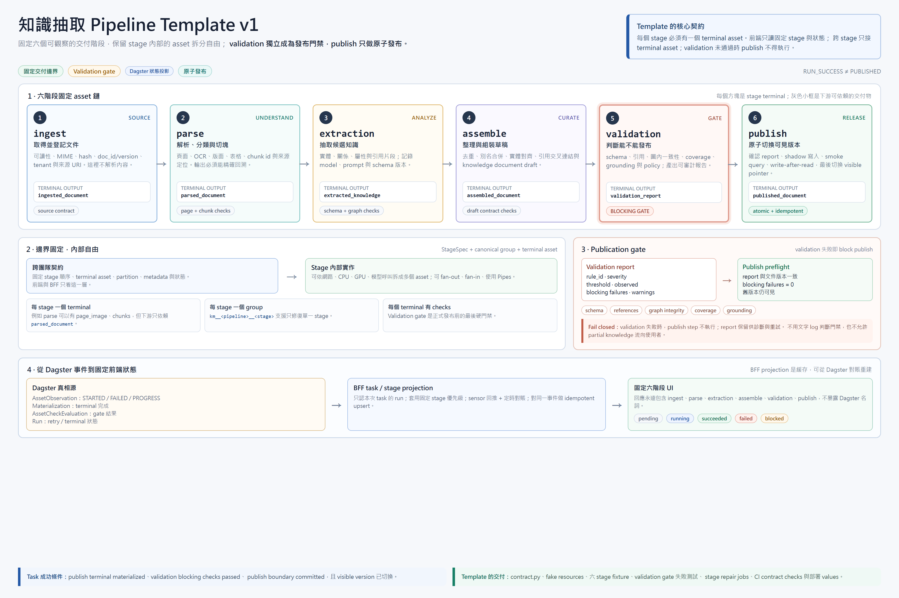
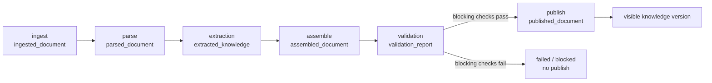

# 30 · 知識抽取 Pipeline Template v1

> 暫定版本：2026-11-06  
> 固定階段：`ingest -> parse -> extraction -> assemble -> validation -> publish`  
> 適用基線：Dagster 1.13.x、Python 3.11  
> 前置閱讀：`docs/28`、`docs/19`、`docs/20`



## 30.0 v1 結論

這版六階段很適合產品化，比前一版更容易向使用者解釋，也把「資料品質」和「發布」的界線拉清楚了：

- **固定 Stage 邊界，內部 Asset 自由**：前端只依賴六個 terminal asset，Pipeline 團隊仍可依資源特性拆分內部 asset。
- **validation 是獨立 stage**：validation 產出可追溯的 `validation_report`，不是藏在 publish 裡的一段 `if`。
- **publish 只負責發布**：publish 不重新計算知識，只執行最後的 preflight、影子寫入、煙霧測試與原子切換。
- **Run 成功不等於已發布**：只有 `publish` stage 完成，且 validation gate 通過，任務才是 `succeeded`。
- **所有 stage 在 v1 都是必要欄位**：即使某條 Pipeline 某階段很薄，也要產出一個明確的 terminal artifact；不要讓前端面對任意可省略的階段。

一句話：

> 前六個階段固定的是「交付責任」，不是每個團隊的演算法、asset 數量或執行方式。

## 30.1 六階段責任

| # | Stage | 使用者看到的含義 | 主要輸入 | Terminal asset | 主要輸出 |
| ---: | --- | --- | --- | --- | --- |
| 1 | `ingest` | 取得並登記文件 | 上傳事件、物件 URI、文件 metadata | `ingested_document` | 已驗證可讀的原件 handle、內容 hash、文件版本 |
| 2 | `parse` | 解析並切分內容 | 原件、解析器設定 | `parsed_document` | 頁面、文字、表格、圖片描述、chunk manifest |
| 3 | `extraction` | 抽取實體與關係 | chunks、抽取 schema、模型設定 | `extracted_knowledge` | 實體、關係、引用片段、模型與 prompt 版本 |
| 4 | `assemble` | 合併整理成候選知識文件 | 抽取結果、既有詞典、引用資料 | `assembled_document` | 去重後知識文件草稿、引用映射、候選 graph projection |
| 5 | `validation` | 驗證能否發布 | 候選文件、上游 manifest | `validation_report` | 通過/失敗報告、規則結果、阻斷原因、可追溯證據 |
| 6 | `publish` | 發布為可檢索版本 | 候選文件、validation report | `published_document` | 可見版本、向量/圖索引、發布 ID、回滾指標 |

### 30.1.1 邊界細節

#### `ingest`

只做「這份文件是否可被安全處理」：

- 文件是否存在、可讀、未加密、MIME/副檔名一致。
- `doc_id`、`doc_version`、內容 hash、tenant、來源 URI 是否完整。
- 不進行 OCR、切塊、LLM 抽取。

#### `parse`

負責把原件變成可抽取內容：

- PDF 頁面、OCR、版面、表格與圖片理解。
- 分類、清洗、正規化、切塊。
- 產出穩定的 chunk id、頁碼與來源定位。
- 不在此階段進行知識實體合併或發布。

#### `extraction`

只負責產生候選知識：

- 實體、關係、屬性、描述、引用片段。
- 每次抽取都記錄 `model_version`、`prompt_version`、`schema_version`。
- LLM 失敗可重試；schema 不合規要能定位到 chunk。
- 不在這裡直接寫入正式向量庫或對外可見的知識文件。

#### `assemble`

負責整理與組裝：

- 實體去重、別名合併、實體對齊、多 chunk 合併。
- 引用交叉連結、圖譜投影、知識文件草稿。
- 任何會改變知識語義的合併規則都要版本化。
- 輸出仍是 draft，不代表已通過 validation。

#### `validation`

負責產生可審計的發布判斷：

- 結構與 schema 驗證。
- 引用可回溯、圖內端點完整、chunk coverage。
- 重複率、空抽取率、grounding 與數量漂移。
- 必要時做 sampling LLM-as-judge，但只作為 WARN 或指定 gate。
- 產出 `validation_report`，包含每條規則的 `rule_id`、`passed`、`severity`、`threshold`、`observed`。

#### `publish`

只做正式發布：

1. 讀取 `assembled_document` 與 `validation_report`。
2. 再次確認 report 的 blocking gate 全部通過。
3. 寫入 shadow index / staging namespace。
4. 執行低成本 smoke query 與寫後核對。
5. 原子切換可見版本指標。
6. 產出 `published_document`。

若 publish 中途失敗，舊版本必須繼續可見，不得留下半發布狀態。

## 30.2 Stage 邊界與 terminal asset

### 30.2.1 固定邊界

```text
ingest terminal
      |
      v
parse terminal
      |
      v
extraction terminal
      |
      v
assemble terminal
      |
      v
validation terminal
      |
      v
publish terminal
```

跨 stage 的 consumer 只能依賴前一個 stage 的 terminal asset。Stage 內部可以自由拆成多個 asset，例如：

```text
parse/
  extract_pages
  classify_pages
  normalize_text
  build_chunks
  parsed_document       <- terminal
```

```text
extraction/
  extract_page_entities
  extract_chunk_relations
  normalize_extraction_schema
  extracted_knowledge   <- terminal
```

### 30.2.2 Canonical group

每個 stage 的所有 asset 都放在固定 group：

```text
km__<pipeline_id>__ingest
km__<pipeline_id>__parse
km__<pipeline_id>__extraction
km__<pipeline_id>__assemble
km__<pipeline_id>__validation
km__<pipeline_id>__publish
```

好處：

- 前端只認 stage 與 terminal asset。
- 修復某 stage 時，可以用 group selection 一次重跑該階段所有內部 asset。
- 不需要把任何內部 asset 暴露給前端。

### 30.2.3 Partition

v1 建議以「文件版本」為 partition，並使用不含 `:` 的安全字串：

```text
partition_key = {doc_id}__{doc_version}
```

同一個 partition 的重跑必須具備冪等性。若產品需要保留多版內容同時可比較，可改成：

```text
partition_key = {doc_id}__{doc_version}
```

並把舊版本保留在物件儲存與業務資料庫，不讓 Dagster partition 集合無限膨脹。

Dagster 預設 `FilesystemIOManager` 會把 partition key 裡的 `::` 誤判為 URI protocol。
除非平台自訂 IO Manager 已明確處理 partition 路徑編碼，否則避免在 partition key 使用冒號。

## 30.3 契約定義

### 30.3.1 Stage contract

```python
from dataclasses import dataclass
from enum import StrEnum

import dagster as dg


class Stage(StrEnum):
    INGEST = "ingest"
    PARSE = "parse"
    EXTRACTION = "extraction"
    ASSEMBLE = "assemble"
    VALIDATION = "validation"
    PUBLISH = "publish"


@dataclass(frozen=True)
class StageSpec:
    stage: Stage
    terminal_asset_key: dg.AssetKey


PIPELINE_ID = "manual_extraction"
PIPELINE_VERSION = "2026.11.1"
OWNER = "team:knowledge"

STAGES = [
    StageSpec(
        Stage.INGEST,
        dg.AssetKey([PIPELINE_ID, "ingested_document"]),
    ),
    StageSpec(
        Stage.PARSE,
        dg.AssetKey([PIPELINE_ID, "parsed_document"]),
    ),
    StageSpec(
        Stage.EXTRACTION,
        dg.AssetKey([PIPELINE_ID, "extracted_knowledge"]),
    ),
    StageSpec(
        Stage.ASSEMBLE,
        dg.AssetKey([PIPELINE_ID, "assembled_document"]),
    ),
    StageSpec(
        Stage.VALIDATION,
        dg.AssetKey([PIPELINE_ID, "validation_report"]),
    ),
    StageSpec(
        Stage.PUBLISH,
        dg.AssetKey([PIPELINE_ID, "published_document"]),
    ),
]

STAGE_ORDER = tuple(spec.stage for spec in STAGES)
TERMINAL_ASSETS = {spec.stage: spec.terminal_asset_key for spec in STAGES}


def stage_group(stage: Stage) -> str:
    return f"km__{PIPELINE_ID}__{stage.value}"
```

### 30.3.2 Definition metadata

每個 terminal asset 都要有：

```python
metadata={
    "km_contract_version": 1,
    "km_pipeline_id": PIPELINE_ID,
    "km_pipeline_version": PIPELINE_VERSION,
    "km_stage_id": stage.value,
    "km_stage_role": "terminal",
    "owner": OWNER,
}
```

CI 必須檢查：

- `km_stage_id` 只能是六個固定值。
- 每個 stage 恰好一個 terminal asset。
- Stage 內所有 asset 使用 canonical group。
- 所有 stage 使用相同 partition definition。
- 跨 stage dependency 只接到 terminal asset。
- `validation` 與 `publish` 必須有 blocking gate。

### 30.3.3 Runtime metadata

`published_document` 至少要帶：

```text
doc_id
doc_version
pipeline_id
pipeline_version
validation_report_id
publication_id
index_namespace
published_at
is_visible
```

`validation_report` 至少要帶：

```text
doc_id
doc_version
validation_policy_version
status: passed | failed
blocking_failures
warnings
rules: [{rule_id, passed, severity, threshold, observed}]
```

不要把完整知識文件或大段原文塞進 metadata，只放可索引的摘要、版本與 URI。

## 30.4 執行與狀態

### 30.4.1 一個 business task 對應一個 document partition

BFF 建立 business task 後，使用 `launchBackfill` 執行該文件的 partition。建議 run tags：

```text
task_id
pipeline_id
doc_id
doc_version
tenant
env
```

### 30.4.2 Stage 狀態

| State | 進入條件 |
| --- | --- |
| `pending` | 尚未排隊 |
| `queued` | run/backfill 已建立，尚未開始 |
| `running` | 收到本次 run 的 stage start signal |
| `succeeded` | terminal materialization 完成，必要 blocking checks 通過 |
| `failed` | 本次 run 最終失敗，且失敗屬於該 stage |
| `blocked` | 上游失敗，本 stage 未執行 |
| `stale` | 有舊結果，但 code/data/upstream 已變更 |
| `canceled` | run 或業務任務被取消 |

v1 不建議讓前端收到任意自訂 state。Pipeline 只提供事件，BFF 做固定映射。

### 30.4.3 關鍵判定

```text
task succeeded
  = publish terminal materialized
  + validation blocking checks passed
  + publish blocking checks passed
  + publish boundary committed
```

以下情況都不能算發布成功：

- Dagster run 是 `SUCCESS`，但 publish 尚未 materialize。
- `published_document` materialize 了，但 `is_visible=false`。
- validation report 存在，但仍有 blocking failure。
- shadow index 寫完，但可見指標尚未切換。

## 30.5 Validation gate

### 30.5.1 兩層品質檢查

| 層級 | 位置 | 是否阻斷 | 例子 |
| --- | --- | --- | --- |
| Stage local check | 每個 terminal asset | 視規則而定 | schema、非空、引用存在、chunk 覆蓋 |
| Publish gate | validation -> publish | **必定阻斷** | validation report 未通過、blocking failure > 0、report 與文件版本不一致 |

建議 validation 的 blocking 規則先限定在低成本、確定性檢查：

- schema 與 enum 合法性。
- relation endpoint 必須存在於 entity 集合。
- 引用 chunk id 必須存在。
- chunk coverage 不得低於契約閾值。
- publish payload 必須可由 downstream reader 反序列化。

LLM-as-judge、grounding 抽樣與召回冒煙可先作為 WARN，等累積分布後再升為 blocking。

### 30.5.2 失敗處理

```text
validation failed
  -> validation_report materialized（可供診斷）
  -> blocking check failure
  -> publish step skipped
  -> BFF 顯示 validation failed
  -> 使用者看到可理解的原因與重試入口
```

不要：

- validation 失敗後仍發布 partial document。
- 在 publish 裡重新做整套 validation。
- 用 run_failure_sensor 的文字訊息判斷 validation 結果。

## 30.6 Publish 的原子性

`publish` 是最需要有明確契約的一個 stage。

### 30.6.1 建議流程

```text
validation_report(passed)
        |
        v
prepare publication_id
        |
        v
write shadow index / graph projection
        |
        v
smoke query + write-after-read check
        |
        v
atomically switch visible version
        |
        v
materialize published_document
```

### 30.6.2 規則

- Publication id 使用 `{pipeline_id}:{doc_id}:{doc_version}:{pipeline_version}` 或以它為基礎的 hash。
- 同一 publication 重跑要覆寫 shadow，不重複建立第二份可見資料。
- 可見版本切換必須是單一 transaction 或單一指標更新。
- 失敗時保留舊版本，不可先刪舊索引再寫新索引。
- 發布後若需要撤回，使用版本指標回滾，不要直接刪除歷史版本。

## 30.7 Template 目錄

本 repo 已提供可直接執行的初版：

```text
pipelines/_template/
```

入口是 `pipelines._template.defs`，本地 demo 可執行
`python -m pipelines._template.demo`。複製後請先修改 `contract.py` 的
`PIPELINE_ID`、partition 與 resources。

```text
pipelines/_template/
├── pyproject.toml
├── Dockerfile
├── README.md
├── copier.yaml
├── src/
│   └── pipeline_name/
│       ├── defs.py
│       ├── contract.py
│       ├── settings.py
│       ├── assets/
│       │   ├── ingest.py
│       │   ├── parse.py
│       │   ├── extraction.py
│       │   ├── assemble.py
│       │   ├── validation.py
│       │   └── publish.py
│       ├── checks/
│       │   ├── contracts.py
│       │   └── quality.py
│       └── resources.py
├── tests/
│   ├── test_contract.py
│   ├── test_pipeline_smoke.py
│   └── test_validation_blocks_publish.py
├── deployment/
│   └── values.yaml
└── scripts/
    ├── dev.ps1
    ├── test.ps1
    └── validate.ps1
```

### 30.7.1 `defs.py`

```python
import dagster as dg

from pipeline_name.assets import ALL_ASSETS
from pipeline_name.checks import ALL_CHECKS
from pipeline_name.contract import (
    PIPELINE_ID,
    STAGES,
    TERMINAL_ASSETS,
    stage_group,
)
from pipeline_name.resources import RESOURCES

pipeline_job = dg.define_asset_job(
    name=f"{PIPELINE_ID}__full",
    selection=dg.AssetSelection.assets(*TERMINAL_ASSETS.values()).upstream(),
)

stage_jobs = [
    dg.define_asset_job(
        name=f"{PIPELINE_ID}__repair_{spec.stage.value}",
        selection=dg.AssetSelection.groups(stage_group(spec.stage)),
    )
    for spec in STAGES
]

defs = dg.Definitions(
    assets=ALL_ASSETS,
    asset_checks=ALL_CHECKS,
    jobs=[pipeline_job, *stage_jobs],
    resources=RESOURCES,
    metadata={
        "km_pipeline_id": PIPELINE_ID,
        "km_contract_version": 1,
    },
)
```

### 30.7.2 標準範例

Template 應內建一個完全使用 fake resources 的文件：

- 1 份小型 PDF fixture。
- 1 個固定 partition。
- 6 個 terminal asset 全部跑通。
- 1 條 validation blocking check 失敗測試。
- 1 個 publish 成功後可見版本檢查。
- 1 個 validation 失敗時 publish 不執行的測試。

## 30.8 Runtime signal

Materialization 只代表完成，不能表示開始。Template 仍建議用 `AssetObservation` 發出：

```text
STARTED
FAILED
PROGRESS
```

每次 observation metadata 至少包含：

```text
km_signal_version
km_pipeline_id
km_stage_id
km_stage_attempt
km_stage_state
```

失敗時再帶：

```text
error_code
error_class
duration_ms
```

注意：

- 重試中的 FAILED 不代表業務任務最終失敗。
- BFF 必須讀 run 是否仍在 retry。
- Observation 不得取代 `dg.Failure`、Asset Check 或 materialization。
- Progress 建議每 10 秒或每 5% 節流一次。

## 30.9 狀態查詢與前端

BFF 建議查詢：

- `assetNodes`：terminal metadata、checks、stale。
- `runOrError`：本次 run 的 status、tags、eventConnection。
- `eventConnection`：stage STARTED / FAILED / PROGRESS。
- `MaterializationEvent`：stage 完成。
- `AssetCheckEvaluation`：validation gate 結果。

前端只接收：

```json
{
  "task_id": "task_01J...",
  "pipeline_id": "manual_extraction",
  "status": "running",
  "current_stage": "validation",
  "stages": [
    {"stage_id": "ingest", "state": "succeeded"},
    {"stage_id": "parse", "state": "succeeded"},
    {"stage_id": "extraction", "state": "succeeded"},
    {"stage_id": "assemble", "state": "succeeded"},
    {"stage_id": "validation", "state": "running"},
    {"stage_id": "publish", "state": "pending"}
  ]
}
```

`stages` 必須永遠按固定順序回傳六筆，即使資料尚未到齊。

## 30.10 示意圖



## 30.11 驗收清單

- [ ] 六個 stage 都只有一個 terminal asset。
- [ ] 每個 stage 的內部 asset 都屬於 canonical group。
- [ ] `validation_report` 能獨立回答「為什麼不能發布」。
- [ ] 所有 validation blocking failures 都會阻止 publish。
- [ ] publish 失敗時舊版本仍可見。
- [ ] publish 成功後 `published_document.is_visible=true`。
- [ ] `RUN_SUCCESS` 不會直接讓前端顯示 `published`。
- [ ] 重試、取消、stale 與 blocked 都有測試。
- [ ] 前端 response 固定返回六個 stage。
- [ ] 新 Pipeline 接入不需要修改 BFF 與前端 stage 枚舉。

## 30.12 與 docs/28 的關係

`docs/28` 記錄了方案調研、狀態投影、錯誤處理、CI 與落地路線。本文只更新 v1 的正式 stage 序列：

```text
ingest -> parse -> extraction -> assemble -> validation -> publish
```

`docs/28` 的以下原則仍然有效：

- 固定 stage 邊界，內部 asset 自由拆分。
- 一個 terminal asset 作為前端契約。
- BFF 做領域狀態投影，不讓前端直連 Dagster。
- Publish 由 blocking checks 和 validation gate 共同保護。
- 用 run status sensor 回推，定時對賬兜底。
- Template 用 Copier/SemVer 維護，而不是永久複製貼上。
